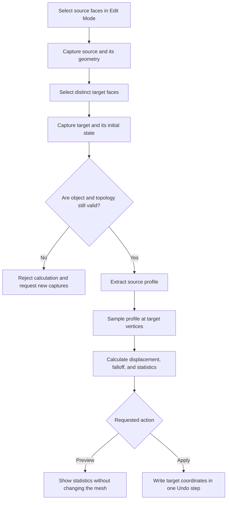
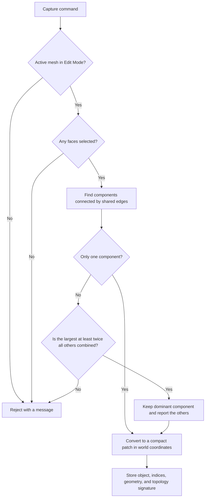
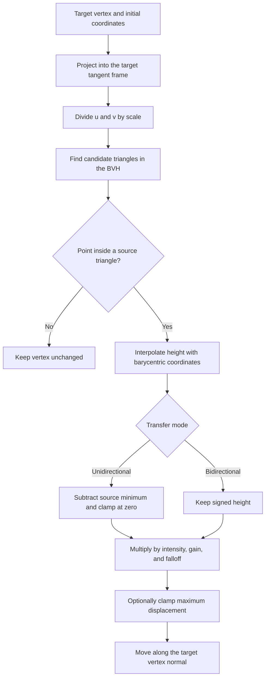
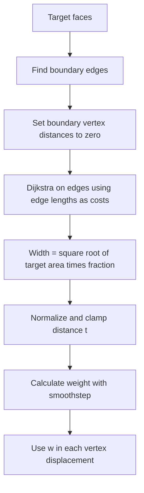
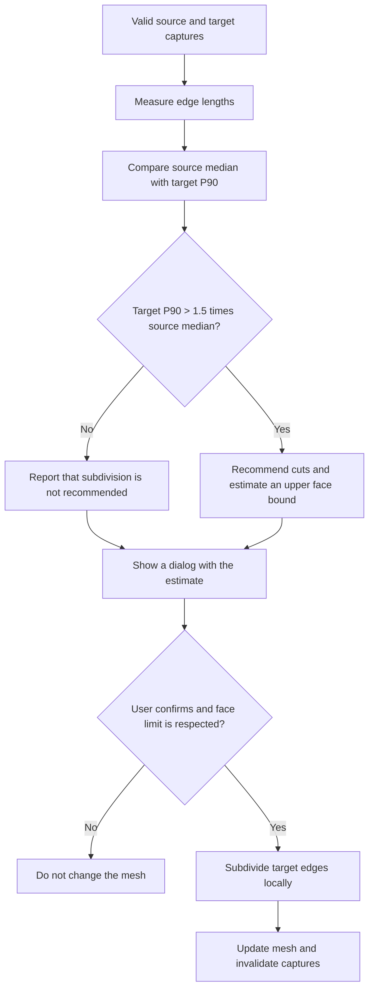

# Algorithms — Clone Relief

[Documentation index](README.en.md) · [Product specifications](SPECIFICATIONS.en.md) · [Development guide](DEVELOPMENT.en.md) · [Français](ALGORITHMS.md)

This document describes how Clone Relief works algorithmically, in execution order. It complements the product requirements with the calculation details and links each step to its implementation. The Mermaid diagrams describe the current flow; the code remains the source of truth if they differ.

## Overview

Clone Relief captures two connected regions on the same object: a source whose profile is sampled, and a target whose vertices are moved. The mathematical core operates on compact copies of these regions without depending on Blender. The Blender adapter validates the captures and writes the result only when the user clicks **Apply**.

## 1. Capturing and validating regions

### Capture

1. The operator requires an active mesh object in **Edit Mode**. The viewport is prepared with Solid shading, X-Ray disabled, and face selection enabled.
2. Selected faces must form one group connected by edges. If several groups are selected, Clone Relief keeps the dominant group only when it contains at least twice the total size of all other groups; the others are deselected and reported. Otherwise, capture is rejected.
3. The capture compacts the selected vertices and faces into a local patch, converts the vertices to world coordinates, and stores the Blender indices needed for later writes.
4. It also stores the object identity and a topology signature: vertex, edge, and face counts; edge connectivity; and face cycles.
5. The target can only be captured after the source. Source and target must belong to the same object and must not share any faces.

Captures are **snapshots**. Moving vertices after capture does not update the stored geometry; recapture the regions to include those changes. Topology changes are detected by the signature and invalidate the captures. Opening another file clears the session captures.

### Validation before Preview or Apply

Before each calculation, the operator checks that both captures exist, belong to the active object, and have the same topology signature as the current mesh. It also checks that source and target faces do not overlap. Any failure stops the calculation before mutation.

## 2. Building the source profile

The profile is built in a 2D tangent frame specific to the source.

1. For each face, calculate an oriented normal and its area. Sum the normals weighted by area, then normalize the result to get the patch's average normal.
2. Choose the least parallel axis among world X, Y, and Z. A cross product produces one tangent axis; a second cross product produces the other. The origin is the arithmetic mean of the captured vertices.
3. For each source vertex, project its offset from the origin onto the two tangent axes to get 2D coordinates `(u, v)`. Its height `h` is the projection of the same offset onto the average normal.
4. Each polygon face is fan-triangulated for spatial search. This triangulation does not change the Blender mesh.
5. Build a 2D BVH over the triangle bounds. At each level, split along the group's largest extent, sort triangles by their bounding-box center on that axis, then divide the list in half. Leaves contain at most eight triangles.

The source field therefore contains samples `(u, v, h)` and the triangles that define its domain. Peaks and valleys are preserved; the active transfer does not smooth the profile.

## 3. Sampling and transfer

For each target vertex, the calculation proceeds as follows:

1. Build the target's tangent frame using the same method as for the source, then project the vertex onto its 2D axes `(u_t, v_t)`.
2. Divide its 2D coordinates by the scale factor: `(u_t / scale, v_t / scale)`. A scale of 2 therefore makes the transferred pattern's wavelength twice as large.
3. Query the BVH to find source triangles whose bounds may contain the point.
4. For each candidate, calculate barycentric coordinates. If all three weights are inside the triangle, within a small numeric tolerance, interpolate the height: `h_s = w₁ h₁ + w₂ h₂ + w₃ h₃`.
5. If no triangle contains the point, it lies outside the source domain and the target vertex remains unchanged. There is no extrapolation.
6. Convert the sampled height to a displacement according to the selected mode, then multiply by intensity, gain, and falloff weight.
7. Add the displacement to the vertex's initial position along its local normal.

### Modes and parameters

Let `h_s` be the interpolated height, `h_min` the smallest source height, `I` the intensity, `G` the gain, `w` the falloff weight, and `n` the target vertex normal.

- **Unidirectional (`OUTWARD`):** `r = max(0, h_s - h_min)`. The whole profile is translated so its lowest point produces zero displacement. Valleys are preserved relative to peaks; the transfer does not move inward.
- **Bidirectional (`BIDIRECTIONAL`):** `r = h_s`. Positive and negative heights are preserved around the source's average plane.
- **Displacement:** `d = r × I × G × w`. If a limit `D_max` is set, clamp `d` to `[-D_max, +D_max]`. The vertex becomes `p' = p + d × n`.
- **Intensity:** a factor from 0 to 1. **Gain:** a positive multiplier, separate from intensity.
- **Scale:** changes the pattern's spatial size by changing the queried coordinates; it does not multiply height.
- **Falloff:** attenuates displacement at the target boundary; its calculation is described below.

The implementation validates parameters before calculation. The core returns new coordinates without mutating its inputs.

## 4. Calculating edge falloff

The mask is calculated on the target edge graph, not by direct distance through space:

1. Find edges used by only one target face; their vertices form the boundary.
2. Initialize the distance of every boundary vertex to zero.
3. Run Dijkstra's algorithm over patch edges, using each 3D edge length as its cost, to calculate an approximate geodesic distance from the boundary.
4. Set the falloff width to `sqrt(target area) × falloff fraction`.
5. Set `t = clamp(distance / width, 0, 1)` and `w = t²(3 − 2t)`. The weight is zero at the boundary and smoothly increases to 1. If the patch has no boundary, all weights are 1.

## 5. Preview, Apply, and reapplying

The calculation shared by Preview and Apply starts from the captured source and target snapshots. It calculates result coordinates, the number of vertices that would move, and the maximum displacement.

- **Preview:** displays these measurements and does not touch the mesh.
- **Apply:** writes the calculated coordinates only to the captured target vertex indices. The Blender operator creates one Undo step.
- **Reapplying:** always uses the original target stored by Capture Target. Changing settings and applying again replaces the result instead of stacking another displacement on top.
- **After subdivision:** captures are cleared because indices and topology have changed. Capture source and target again.

## 6. Resolution diagnosis and densification

The diagnosis compares source and target edge lengths. The median source edge length defines the reference spacing. If the target's 90th-percentile edge length exceeds `1.5 ×` that median, the target is flagged as potentially too coarse. The recommended cut count aims to bring that percentile down to the source spacing.

Before subdivision, Clone Relief estimates an upper bound on the face count. For a triangle subdivided with `c` cuts per edge, the estimated factor is `(c + 1)²`; polygons with more than three sides are estimated conservatively through their triangulation. Faces adjacent to subdivided edges are included.

The dialog lets the user set the cuts (maximum 8) and maximum added faces (250,000 by default). Subdivision is explicit and undoable; it never runs automatically as part of the transfer.

## 7. Topology check

The check scans the mesh without modifying it. It counts edge-connected components, boundary, wire, and non-manifold edges, non-manifold or isolated vertices, and degenerate faces. The component locator selects a component by face count and frames the view; it does not change geometry.

This diagnostic does not detect self-intersections or internal surfaces, and it does not repair defects. It does not replace checks in the 3D Print Toolbox, a slicer, or a qualification print.

## Geometric limitations to keep in mind

- Source and target are projected independently into tangent frames derived from world axes; no interactive rotational alignment is calculated.
- A planar projection may distort correspondence on strongly curved, folded, or distorted regions.
- No relief is transferred outside the 2D domain covered by the source.
- A low-density target cannot represent fine details without prior local densification.
- The topology check does not prove printability and does not analyze self-intersections or internal cavities.

## Code map

| Step | Implementation |
|---|---|
| Selection, world-space snapshots, and capture validation | `src/clone_relief/blender_adapter.py` |
| Tangent frames, normals, graph distances, and falloff | `src/clone_relief/geometry.py` |
| Profile extraction, BVH, interpolation, and displacement | `src/clone_relief/relief.py` |
| Resolution diagnosis and cost estimate | `src/clone_relief/density.py` |
| Preflight, Preview, Apply, audit, and Blender subdivision | `src/clone_relief/operators.py` |

`relief.py` also contains a reference Taubin smoothing function with a pinned boundary (`smooth_reference`). The active transfer does not call it, and it is not part of the flow described above.
