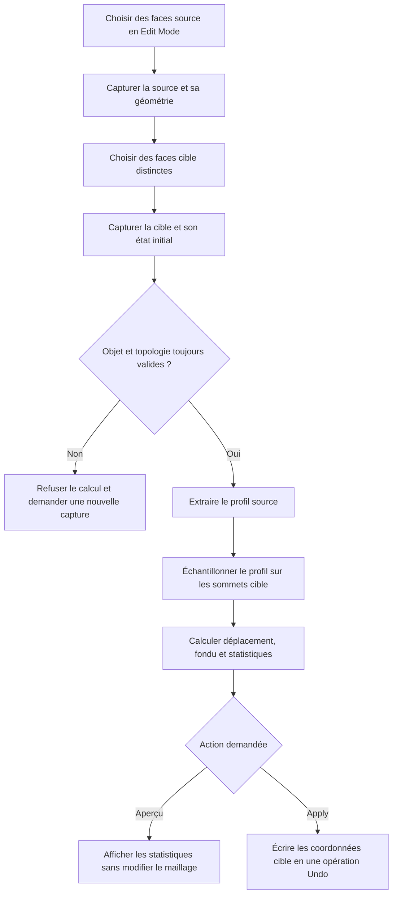
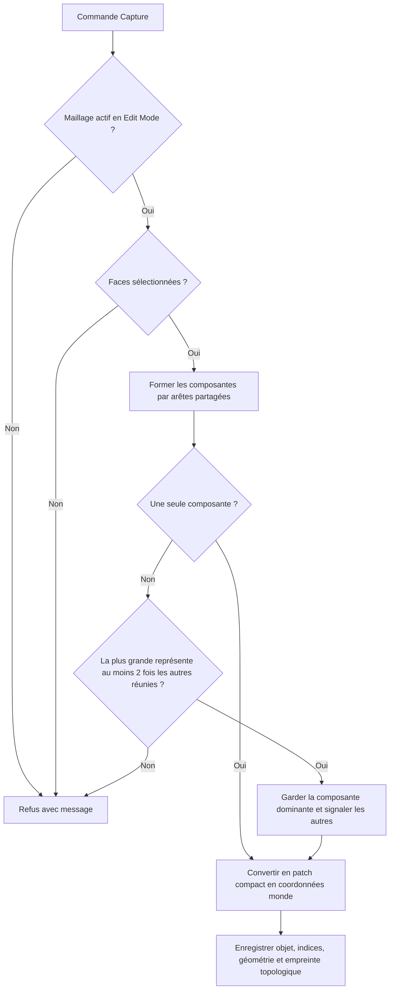
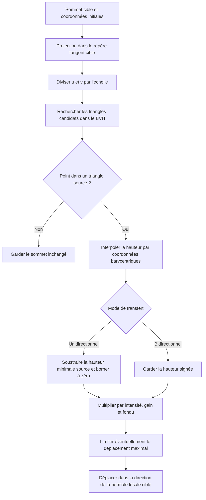
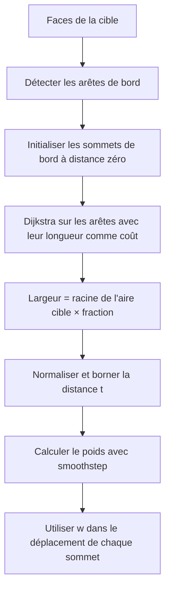
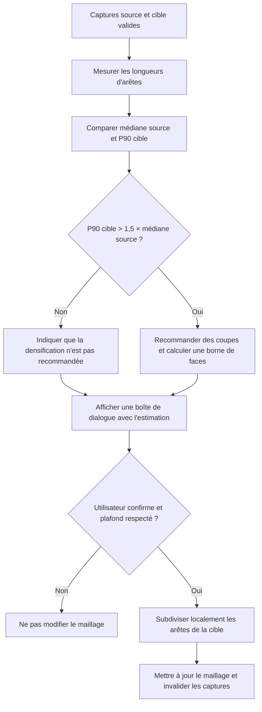

# Algorithmes — Clone Relief

[Index de la documentation](README.md) · [English](ALGORITHMS.en.md) · [Spécifications produit](SPECIFICATIONS.md) · [Guide de développement](DEVELOPMENT.md)

Ce document décrit le fonctionnement algorithmique de Clone Relief, dans l’ordre où les opérations sont exécutées. Il complète les exigences produit par le détail du calcul et relie chaque étape au code qui l’implémente. Les diagrammes Mermaid décrivent le flux actuel; le code reste la source de vérité en cas de divergence.

## Vue d’ensemble

Clone Relief capture deux régions connectées d’un même objet : une source dont le profil est échantillonné et une cible dont les sommets seront déplacés. Le noyau mathématique travaille sur des copies compactes des régions, sans dépendre de Blender. L’adaptateur Blender vérifie les captures et écrit le résultat seulement lors de **Apply**.

## 1. Capture et validation des régions

### Capture

1. L’opérateur exige un objet maillé actif en **Edit Mode**. La vue est préparée en affichage Solid, X-Ray désactivé et sélection de faces.
2. Les faces sélectionnées doivent former un groupe connecté par des arêtes. Si plusieurs groupes sont sélectionnés, Clone Relief retient le groupe dominant uniquement si celui-ci contient au moins deux fois le total des autres groupes; les autres sont désélectionnés et signalés. Sinon, la capture est refusée.
3. La capture compacte les sommets et faces sélectionnés dans un patch local, convertit les sommets en coordonnées monde et conserve les indices Blender nécessaires à l’écriture future.
4. Elle mémorise aussi l’identité de l’objet et une empreinte de sa topologie : nombres de sommets, d’arêtes et de faces, connexions d’arêtes et cycles des faces.
5. La cible n’est capturable qu’après la source. Source et cible doivent appartenir au même objet et ne partager aucune face.

Les captures sont des **instantanés**. Modifier les coordonnées après capture ne met pas à jour les données capturées; recapturer les régions pour prendre en compte ces changements. Une modification de topologie est détectée par l’empreinte et invalide les captures. Ouvrir un autre fichier efface les captures de la session.

### Validation avant aperçu ou Apply

À chaque calcul, l’opérateur vérifie que les deux captures existent, correspondent à l’objet actif et ont la même empreinte topologique que le maillage courant. Il vérifie également que les faces source et cible ne se chevauchent pas. Toute erreur arrête le calcul avant mutation.

## 2. Construction du profil source

Le profil est construit dans un repère tangent 2D propre à la source.

1. Pour chaque face, calculer une normale orientée et son aire. Faire la somme des normales pondérées par l’aire, puis normaliser pour obtenir la normale moyenne du patch.
2. Choisir parmi les axes monde X, Y et Z celui qui est le moins parallèle à cette normale. Le produit vectoriel fournit un axe tangent; un second produit vectoriel fournit le deuxième axe tangent. L’origine est la moyenne arithmétique des sommets capturés.
3. Pour chaque sommet source, projeter son décalage depuis l’origine sur les deux axes tangents : on obtient ses coordonnées 2D `(u, v)`. Sa hauteur `h` est la projection du même décalage sur la normale moyenne.
4. Chaque face polygonale est triangulée en éventail pour la recherche spatiale. Cette triangulation ne modifie pas le maillage Blender.
5. Construire une hiérarchie BVH 2D sur les boîtes des triangles. À chaque niveau, couper selon la plus grande étendue du groupe, trier les triangles par le centre de leur boîte sur cet axe, puis partager la liste en deux. Les feuilles contiennent au plus huit triangles.

Le champ source contient donc des échantillons `(u, v, h)` et les triangles qui définissent son domaine. Les bosses et les creux sont gardés : aucun lissage n’est appliqué au transfert principal.

## 3. Échantillonnage et transfert

Pour chaque sommet de la cible, le calcul procède comme suit :

1. Construire le repère tangent de la cible avec la même méthode que pour la source, puis projeter le sommet sur les axes 2D `(u_t, v_t)`.
2. Diviser ses coordonnées 2D par le facteur d’échelle : `(u_t / échelle, v_t / échelle)`. Une échelle de 2 agrandit donc le motif transféré à deux fois sa longueur d’onde.
3. Interroger le BVH pour trouver les triangles source dont les boîtes peuvent contenir le point.
4. Pour chaque candidat, calculer les coordonnées barycentriques. Si les trois poids sont dans le triangle (avec une petite tolérance numérique), interpoler la hauteur : `h_s = w₁ h₁ + w₂ h₂ + w₃ h₃`.
5. Si aucun triangle ne contient le point, le sommet est hors du domaine source et reste inchangé. Il n’y a pas d’extrapolation.
6. Transformer la hauteur échantillonnée en déplacement selon le mode, puis la multiplier par l’intensité, le gain et le poids de fondu.
7. Ajouter ce déplacement à la position initiale du sommet cible, dans la direction de sa normale locale.

### Modes et paramètres

Soit `h_s` la hauteur interpolée, `h_min` la plus petite hauteur source, `I` l’intensité, `G` le gain, `w` le poids de fondu et `n` la normale du sommet cible.

- **Unidirectionnel (`OUTWARD`) :** `r = max(0, h_s - h_min)`. Le profil entier est translaté de façon que son point le plus bas donne un déplacement nul. Les creux sont conservés par rapport aux bosses; le transfert ne pousse pas vers l’intérieur.
- **Bidirectionnel (`BIDIRECTIONAL`) :** `r = h_s`. Les hauteurs positives et négatives sont conservées autour du plan moyen de la source.
- **Déplacement :** `d = r × I × G × w`, puis, si une limite `D_max` est définie, borner `d` à l’intervalle `[-D_max, +D_max]`. Le sommet devient `p' = p + d × n`.
- **Intensité :** facteur entre 0 et 1. **Gain :** facteur multiplicatif positif, séparé de l’intensité.
- **Échelle :** change la taille spatiale du motif en changeant les coordonnées interrogées; elle ne multiplie pas la hauteur.
- **Fondu :** atténue le déplacement au bord de la cible; sa construction est décrite ci-dessous.

L’implémentation valide les paramètres avant le calcul. Le noyau retourne de nouvelles coordonnées sans modifier ses entrées.

## 4. Calcul du fondu de bord

Le masque est calculé sur le graphe des arêtes de la cible, pas avec une distance directe dans l’espace :

1. Repérer les arêtes utilisées par une seule face cible; leurs sommets forment la frontière.
2. Initialiser la distance de tous les sommets frontière à zéro.
3. Exécuter Dijkstra sur les arêtes du patch, avec la longueur 3D de chaque arête comme coût, pour obtenir une distance géodésique approximative à la frontière.
4. Définir la largeur du fondu comme `sqrt(aire cible) × fraction de fondu`.
5. Poser `t = clamp(distance / largeur, 0, 1)` et `w = t²(3 − 2t)`. Le poids est donc nul au bord et augmente en douceur jusqu’à 1. Si le patch n’a pas de frontière, tous les poids valent 1.

## 5. Aperçu, Apply et réapplication

Le calcul commun à l’aperçu et à Apply repart des instantanés source et cible. Il calcule les coordonnées résultat, le nombre de sommets qui bougeraient et le déplacement maximal.

- **Aperçu :** affiche ces mesures et ne touche pas au maillage.
- **Apply :** écrit les coordonnées calculées uniquement aux indices de sommets de la cible capturée. L’opérateur Blender constitue une seule étape Undo.
- **Réapplication :** utilise toujours la cible initiale enregistrée lors de Capture Target. Changer les réglages et refaire Apply remplace donc le résultat, au lieu d’ajouter un second déplacement au précédent.
- **Après subdivision :** les captures sont effacées, car les indices et la topologie ont changé. Il faut capturer à nouveau source et cible.

## 6. Diagnostic de résolution et densification

Le diagnostic compare les longueurs d’arêtes des deux patches. La médiane des arêtes source définit l’espacement de référence. Si le 90e percentile des arêtes cible dépasse `1,5 ×` cette médiane, la cible est signalée comme potentiellement trop grossière. Le nombre de coupes recommandé vise à ramener ce percentile à l’espacement source.

Avant toute subdivision, Clone Relief estime une borne supérieure du nombre de faces : pour un triangle subdivisé avec `c` coupes par arête, le facteur de subdivision utilisé est `(c + 1)²`; les polygones de plus de trois côtés sont estimés de façon prudente via leur triangulation. Les faces adjacentes qui partagent les arêtes subdivisées sont incluses.

La boîte permet de régler les coupes (plafonnées à 8) et le nombre maximal de faces ajoutées (250 000 par défaut). La subdivision est explicite et annulable; elle ne s’exécute jamais automatiquement avec le transfert.

## 7. Contrôle topologique

Le contrôle parcourt le maillage sans le modifier. Il compte les composantes reliées par arêtes, les arêtes ouvertes, filaires et non-manifold, les sommets non-manifold ou isolés, et les faces dégénérées. Le localisateur de composantes sélectionne une composante choisie par son nombre de faces et cadre la vue; il ne change pas la géométrie.

Ce diagnostic ne détecte ni les auto-intersections ni les surfaces internes, et ne répare aucun défaut. Il ne remplace pas les contrôles du 3D Print Toolbox, du trancheur ou une impression de qualification.

## Limites géométriques à garder en tête

- Source et cible sont projetées indépendamment dans des repères tangents déterminés à partir des axes du monde; aucun alignement rotatif interactif n’est calculé.
- Une projection plane peut déformer les correspondances sur une région fortement courbe, repliée ou distordue.
- Hors du domaine 2D couvert par la source, aucun relief n’est transféré.
- Une cible peu dense ne peut représenter les détails fins sans densification locale préalable.
- Le contrôle topologique ne prouve pas l’imprimabilité et n’analyse pas les auto-intersections ni les cavités internes.

## Correspondance avec le code

| Étape | Implémentation |
|---|---|
| Sélection, instantanés monde et validation des captures | `src/clone_relief/blender_adapter.py` |
| Repères tangents, normales, distances sur le graphe et fondu | `src/clone_relief/geometry.py` |
| Extraction du profil, BVH, interpolation et déplacement | `src/clone_relief/relief.py` |
| Diagnostic de résolution et estimation du coût | `src/clone_relief/density.py` |
| Prévalidation, aperçu, Apply, audit et subdivision Blender | `src/clone_relief/operators.py` |

`relief.py` contient aussi une fonction de lissage Taubin de référence, avec bord fixé (`smooth_reference`). Elle n’est pas appelée par le transfert actif et ne fait pas partie du flux décrit ci-dessus.
