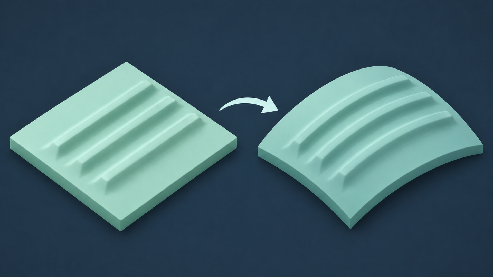
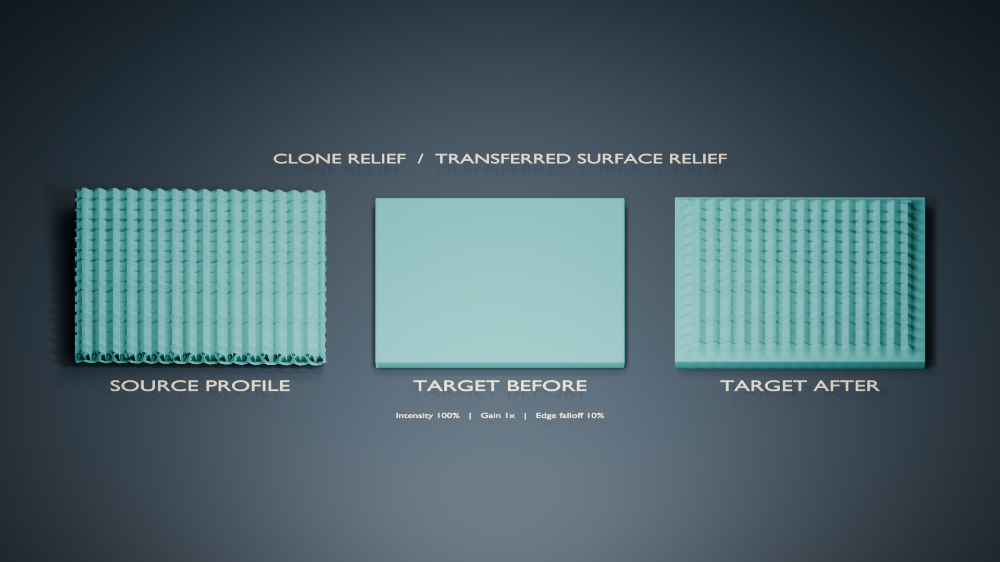

# Clone Relief

[Français](PROJECT_OVERVIEW.md)

## Transfer surface detail from one region of a mesh to another

Has one area lost its relief while another part of the same object still has a
useful profile? Clone Relief lets you capture that source, choose a target, and
transfer the relief directly onto the mesh in Blender.



The result changes geometry; it is not a texture. You control the amplitude,
scale, edge falloff, and transfer direction.

## How to use it

1. **Work on a copy** of the mesh object.
2. In **Edit Mode**, select and capture a connected source region.
3. Select and capture a separate target region on the same object.
4. Adjust the transfer, run the numeric preview, then apply it when the
   displacement looks right.

The preview reports how many vertices would move and the maximum displacement;
it does not change the geometry. Each application starts from the captured
target coordinates, and the operation can be undone.



After transferring relief, you can temporarily compare the target before and
after, inspect topology, locate disconnected components, or export the active
object as an STL with millimeter conversion.

## When it fits

Clone Relief is useful for local transfer when a mesh already contains a region
that can serve as a reference: scan detail, organic texture, or a repeated
surface pattern. Source and target must belong to the same object. A highly
curved or undersampled target may produce a less faithful result.

The tool does not reconstruct the exact detail missing from a scan. It does not
automatically repair holes, intersections, or internal surfaces, and a report
with no detected defects does not guarantee printability.

## For developers

The geometric core in `src/clone_relief/geometry.py` and `relief.py` is Python
and has no `bpy` dependency. Blender integration lives in `blender_adapter.py`,
`operators.py`, and `ui.py`.

The project targets Python 3.11 for tests and has been verified with Blender
4.5.8 LTS on Intel macOS. From the repository root, create an environment and
install the test dependencies:

```bash
python3.11 -m venv .venv
. .venv/bin/activate
python -m pip install -e '.[test]'
python -m pytest -q
```

Geometry tests use synthetic meshes. The Blender smoke-test procedure,
architecture, and known limitations are documented in the [Development
Guide](DEVELOPMENT.en.md). Contributions and issue reports are welcome on
[GitHub](https://github.com/frchalaoux/Blender-CloneRelief).

Clone Relief is released under the [GNU GPL version 3 or later](../LICENSE).
