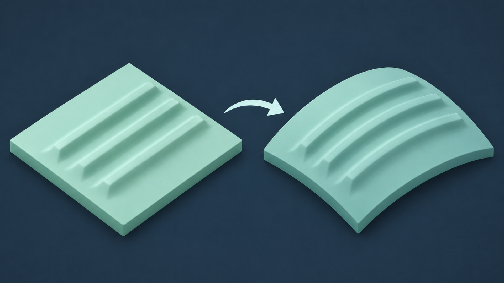
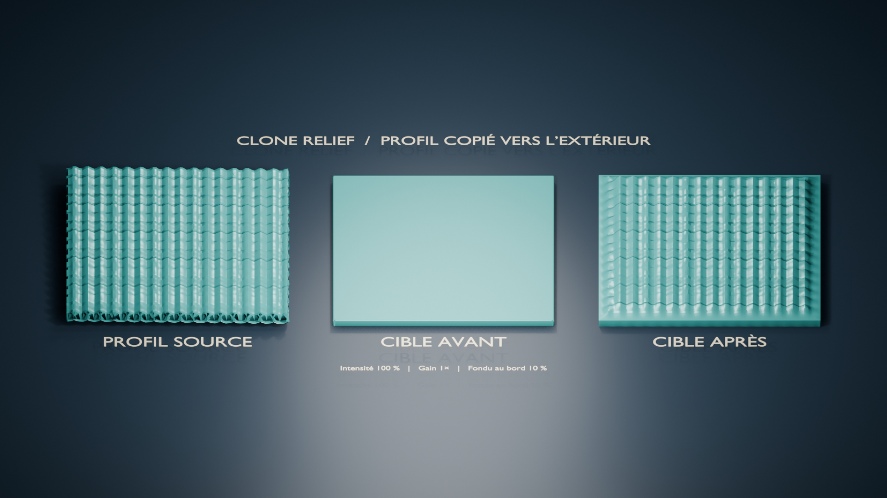

# Clone Relief

[English translation](PROJECT_OVERVIEW.en.md)

## Transférez un détail de surface d’une zone du maillage à une autre

Une zone a perdu son relief, tandis qu’une autre partie du même objet conserve
un profil utile ? Clone Relief permet de capturer cette source, de choisir une
cible, puis de transférer le relief directement sur le maillage dans Blender.



Le résultat est un changement de géométrie, pas une texture. Vous gardez la
main sur l’amplitude, l’échelle, le fondu de bord et la direction du transfert.

## Utilisation

1. **Travaillez sur une copie** de l’objet maillé.
2. En **Edit Mode**, sélectionnez une zone source connectée et capturez-la.
3. Sélectionnez une zone cible distincte sur le même objet et capturez-la.
4. Réglez le transfert, lancez l’aperçu chiffré, puis appliquez le résultat
   lorsque l’amplitude vous convient.

L’aperçu indique combien de sommets seraient déplacés et de quelle distance
maximale; il ne modifie pas la géométrie. Chaque application repart des
coordonnées de la cible capturée, et l’opération peut être annulée avec Undo.



Après le transfert, vous pouvez comparer temporairement la cible avant et après,
examiner la topologie, localiser des composantes déconnectées ou exporter
l’objet actif en STL avec conversion en millimètres.

## Pour quels cas ?

Clone Relief convient à un transfert local lorsque le maillage contient déjà
une zone dont le profil peut servir de référence : détail d’un scan, texture
organique ou motif de surface répété. La source et la cible doivent appartenir
au même objet; une cible très courbe ou trop peu dense peut produire un résultat
moins fidèle.

L’outil ne reconstitue pas le détail exact absent du scan. Il ne répare pas
automatiquement les trous, les intersections ni les surfaces internes, et un
rapport sans défaut détecté ne garantit pas l’imprimabilité.

## Pour les développeurs

Le noyau géométrique de `src/clone_relief/geometry.py` et `relief.py` est écrit
en Python et ne dépend pas de `bpy`. L’adaptateur Blender, les opérateurs et le
panneau se trouvent dans `blender_adapter.py`, `operators.py` et `ui.py`.

Le projet cible Python 3.11 pour les tests et a été vérifié dans Blender 4.5.8
LTS sur macOS Intel. Depuis la racine du dépôt, créez un environnement puis
installez les dépendances de test :

```bash
python3.11 -m venv .venv
. .venv/bin/activate
python -m pip install -e '.[test]'
python -m pytest -q
```

Les tests géométriques utilisent des maillages synthétiques. La procédure du
smoke test Blender, l’architecture et les limites connues sont détaillées dans
le [guide de développement](DEVELOPMENT.md). Les contributions et rapports de
problème sont les bienvenus sur [GitHub](https://github.com/frchalaoux/Blender-CloneRelief).

Clone Relief est publié sous licence [GNU GPL version 3 ou ultérieure](../LICENSE).
