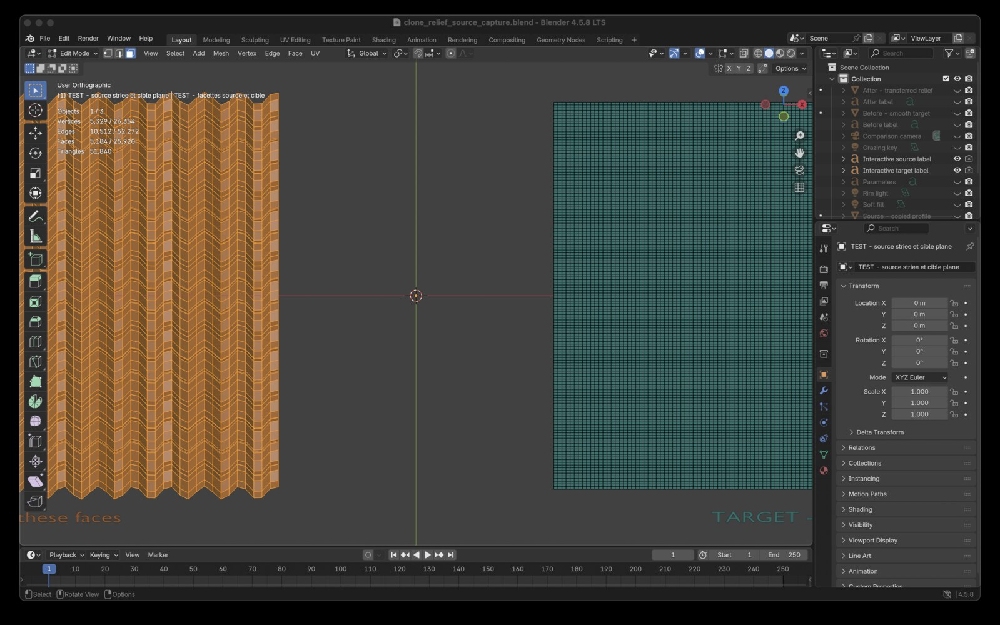
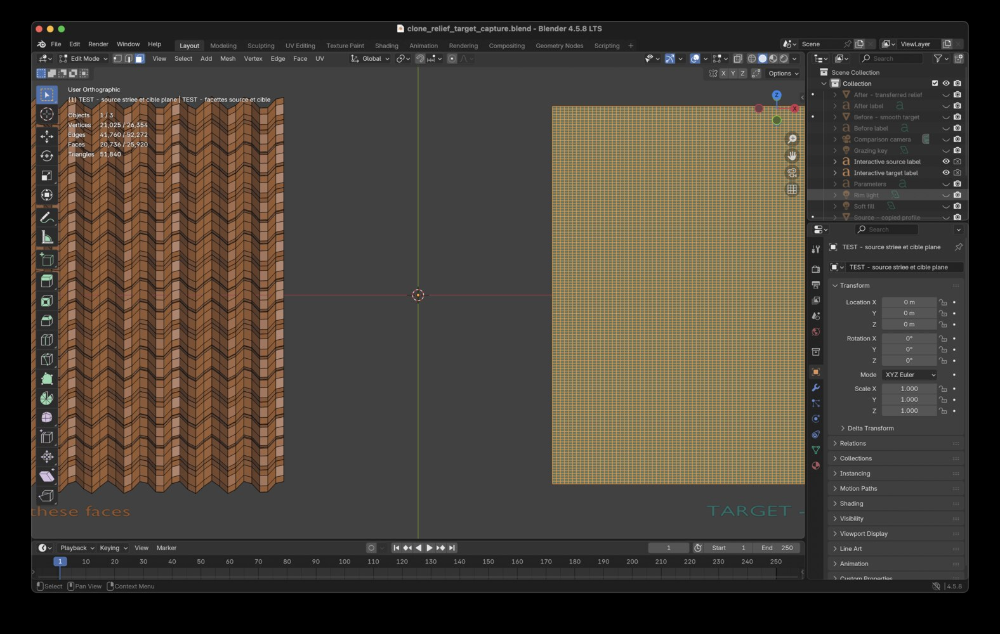
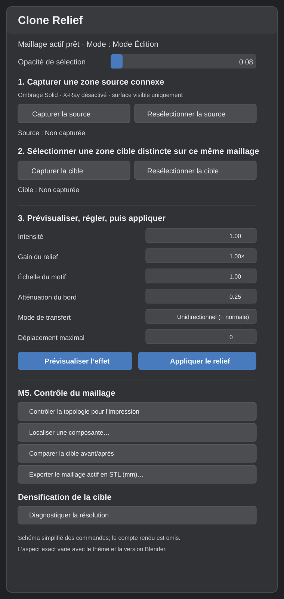
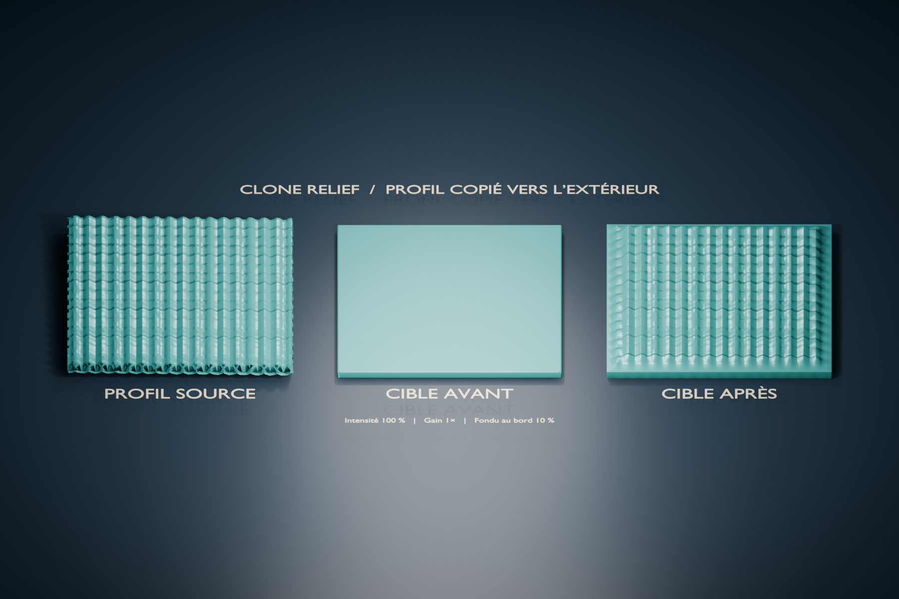

# Clone Relief User Guide

[English](USER_GUIDE.en.md) · [Français](USER_GUIDE.md)

**Prototype:** version 0.2.0 for Blender 4.5.8 LTS. The M5 check has been
used on a Pika scan, but the relief transfer has not yet been validated on it,
and the add-on is not qualified for 3D printing.

**Language:** The add-on interface follows Blender's selected language in
English and French. To show French, enable **Interface** under **Edit →
Preferences → Interface → Translation**. Other Blender languages fall back to
English. Version 0.2.0 localizes the panel, buttons, dialogs, tooltips, and
reports. Screenshots in this guide may show the French interface.

## Installation on macOS

### Install the published release (recommended)

1. Download the [Clone Relief 0.2.0 ZIP archive](https://github.com/frchalaoux/Blender-CloneRelief/releases/download/v0.2.0/blender_clone_relief_0.2.0.zip). Do not extract it.
2. In Blender 4.5.8, open **Blender → Preferences**, then **Get Extensions**.
3. From the menu at the top right, choose **Install from Disk…** and select the downloaded ZIP.
4. In Preferences, search for **Clone Relief** and enable the add-on.
5. In the 3D View, open the sidebar with **N**, then choose the **Clone Relief** tab.

For this route, you do not need to install or run Python separately, or to have a source checkout. Blender runs the add-on using the Python interpreter bundled inside Blender. That interpreter is separate from the standalone `python3.11` command used in the build instructions below.

### Build the ZIP from source (developers only)

Skip this section if you only want to install the published release. It is for developers rebuilding the ZIP from source. Here, `python3.11` means a standalone Python 3.11 installation on your computer, available as a command in Terminal. It is separate from Blender's bundled Python, even if both have the same version number. The script does not install Python. If Terminal says `python3.11` is not found, install standalone Python 3.11 before running this command.

```bash
python3.11 scripts/build_addon_zip.py
```

This creates `dist/blender_clone_relief_0.2.0.zip`, but it does **not** install the add-on. To use the locally built ZIP, follow the Blender steps above and select the file in `dist/`.

When the add-on is enabled and a Blender file is opened, the view is prepared
in **Solid** shading, with **X-Ray disabled** and face selection enabled.

Blender 4.5 documents installation from a ZIP file, including for legacy
add-ons, in the [official Add-ons guide](https://docs.blender.org/manual/en/4.5/editors/preferences/addons.html).

## Recommended workflow: capture, preview, apply

Capture and relief transfer are performed in **Edit Mode**, on the same mesh
object:

1. On a working copy in **Edit Mode**, choose **Solid** shading and disable
   **X-Ray** so selection does not pass through the object. Select faces in a
   healthy, sufficiently textured region, then click **Capture Source**. The
   panel reports the number of captured faces and vertices. If you deselect the
   region later, **Reselect Source** restores it.

   

   *Synthetic demonstration: the orange selection is limited to the source profile; the target on the right is deselected.*

2. Select faces in the target region, then click **Capture Target**. The faces
   must form one continuous patch connected by edges. If the selection also
   touches small disconnected patches, the tool keeps the dominant group only
   when it has at least twice as many faces as all the other groups combined;
   it then reports how many faces were excluded. Otherwise, capture is
   rejected. The source and target must not share faces. **Reselect Target**
   restores the captured target, including after Apply.

   

   *The ridged source remains visible on the left to show both regions on the same mesh.*

3. Click **Preview Effect**. The preview does not modify the mesh: it reports
   how many vertices would move and the maximum displacement in millimeters.
   You can change settings and preview as often as needed; every calculation
   starts from the geometry stored by **Capture Target**.
4. If the panel reports that the target is too coarse, run
   **Diagnose Resolution**, then **Subdivide Target…** and check the estimated
   face count before confirming. Densifying adds vertices and faces to the
   target region so that it can represent finer detail. Subdivision invalidates
   captures: capture the source and target again, then preview again.
5. If the preview reports displacement below **0.05 mm**, try the suggested
   **Relief Gain** or capture a more textured source. Preview again until the
   amplitude is suitable for the result you want.
6. Click **Apply Relief**. The panel reports whether the operation succeeded,
   the number of moved vertices, and their maximum displacement. The captured
   target remains the reference: you can change settings, preview again, and
   click **Apply Relief** again. Each application replaces the previous result
   using the captured coordinates, rather than accumulating relief. The
   operation can be undone with **Undo**.

To work on another region, select it and click **Capture Target**; that capture
becomes the new starting geometry. Any topology change invalidates captures and
requires recapturing the source and target. After an application, manual edits
to target vertices will be replaced by the next result calculated from the
capture.

**Reselect Source** and **Reselect Target** restore faces saved in memory
without recapturing or changing geometry. They require Edit Mode on the same
object and unchanged topology. Captures disappear when the file is closed or
the add-on is reloaded.

The sidebar shows captured face and vertex counts, along with the latest result
or error message. A topology change invalidates the captures.

### Interface reference

The diagram below shows the current sections and commands in the **Clone
Relief** tab. It is a reading aid, not a screenshot: Blender adjusts the layout
to the panel size and theme.



A rejected capture with multiple groups reports how many edge-connected
patches were selected. Keep only the intended patch and capture again; a
rejected attempt does not replace an earlier valid capture. If the tool
automatically keeps a dominant group, check the number of excluded faces
before continuing.

## Settings

| Setting | Default | Effect |
|---|---:|---|
| Selection Opacity | 0.08 (8%) | Reduces the orange fill on selected faces so the mesh is easier to see. Affects the 3D View selection color while the add-on is enabled; the original theme value is restored when disabled. |
| Intensity | 1.00 | Copies the complete profile; a lower value reduces its amplitude. |
| Relief Gain | 1.0× | Multiplies transferred amplitude; values above 1 exaggerate relief. Adjustable up to 100×. |
| Pattern Scale | 1.00 | Physical scale of the pattern; 2.00 doubles its wavelength. |
| Edge Falloff | 0.25 | Relative width of the falloff from the target boundary. |
| Transfer Mode | Unidirectional | Copies the source profile and shifts it outward just enough to keep it above the target. Bidirectional mode preserves signed offsets around the mean plane. |
| Maximum Displacement | 0 | No limit; a positive value caps displacement in scene units. |

**Preview Effect** calculates the result without changing mesh coordinates.
**Apply Relief** is the only one of these steps that moves vertices.

To copy the profile without changing its amplitude, keep intensity at 1, gain
at 1, and scale at 1. Falloff intentionally reduces displacement near the
boundary; reduce its width to narrow this transition.

Messages distinguish success, low amplitude, no moved vertices, and capture
or topology errors. They appear line by line in a scrollable area just below
**Preview Effect** and **Apply Relief**; each line can be selected, and
**Copy Full Message** copies the complete text. A successful result reports the
number of changed vertices and maximum displacement. A result below 0.05 mm is
flagged as very small; this is a visual reference, not a printability
guarantee.

## Diagnosis and local densification

After capturing source and target, **Diagnose Resolution** compares the target
90th-percentile edge length with the source median. Above `1.5×`, the panel
flags a potentially coarse target and suggests a number of cuts. This
threshold is indicative; it does not guarantee that the transferred pattern
will be sampled correctly.

**Subdivide Target…** opens a confirmation dialog showing the number of cuts,
a cautious face-count estimate, and the added-face ceiling (250,000 by
default). Check the estimate before confirming. Subdivision preserves boundary
positions and may also subdivide neighboring faces that share target edges.
Recapture the source and target afterwards.

## M5: topology check, comparison, and STL export

In **M5. Mesh Inspection**, click **Check Topology for Printing**
to analyze the active mesh object. The report lists edge-connected components, open boundaries,
wire and non-manifold edges, non-manifold or isolated vertices, and degenerate
faces. It does not modify the mesh. Multiple components may be intentional,
and no detected defect does not certify that a solid is printable: self-
intersections and internal surfaces are not searched for.

### Step-by-step procedure

1. In the Outliner, expand the scene and choose the **mesh to inspect**.
   Unhide it with the eye icon if needed, then make it active. The check applies
   only to this object; it does not combine multiple selected objects.
2. Click **Check Topology for Printing**.
   This command works in Object Mode and Edit Mode. Read the Clone Relief report in the N-panel below the add-on
   controls. The report does not change the selection or geometry.
3. Read **Edge-Connected Components**. A component is a group of faces joined
   by edges. Multiple components indicate separate islands in that object;
   this alone does not mean they intersect or should be deleted.
4. To inspect an island, keep the same object active, enter **Edit Mode**, then
   click **Locate a Component…**. Choose the row showing its rank and face
   count, then confirm. Clone Relief replaces the current selection with the
   component and frames the view around it; it does not delete or move geometry.
5. To inspect another object, leave Edit Mode, choose that object in the
   Outliner, and repeat. **Locate** is not enabled in Object Mode and has
   nothing to offer when the active object has only one component. If topology
   changes while the choice list is open, cancel and run the locator again.

Component count depends on the selected object. In the M6 butternut analysis
file, `BUTTERNUT_010` (the original) has three components;
`BUTTERNUT_010.001` (the working copy) and `M6_FORMWARE_REPAIRED_TEMP` (the
imported Formware STL) each have one. The topology check is still useful on the
Formware STL because it reports open boundaries, non-manifold edges, and
degenerate faces; the locator will not find a separate island in that object.

For a more complete analysis, Blender offers the
[3D Print Toolbox](https://extensions.blender.org/add-ons/print3d-toolbox/),
listed as compatible with Blender 4.2 and later. It provides **Solid**,
**Intersections**, **Degenerate**, **Thickness**, **Shells**, **Edge Sharp**,
and **Overhang** checks. The Clone Relief report remains useful for finding
and locating components; it does not replace these checks.

After **Apply Relief**, click **Compare Target Before and After** in Edit Mode to
build a temporary side-by-side pair of surfaces from the captured target and
current result. The working mesh is hidden during comparison. These surfaces
are open copies for visual inspection, not printable parts. Click **Return to Work Mesh** before resuming editing or exporting. The comparison covers
only the captured target faces.



*Illustrative result from a test scene; it does not predict results on a real scan.*

**Export Active Mesh as STL (mm)…** opens the file browser and exports only
the active mesh object, with evaluated modifiers. Conversion to millimeters
uses the scene’s physical scale (`scale_length`) and object transforms. An STL
does not store units: check imported dimensions in the slicer before printing.
Make sure the working object is active and the temporary comparison has been
cleared. Export checks the transfer; it does not repair or certify the mesh’s
manufacturability. Blender documents selected-object export, scale, scene
units, axes, and modifier application in its [STL 4.5 manual](https://docs.blender.org/manual/en/4.5/files/import_export/stl.html).

The [M6 protocol](PRINT_QUALIFICATION.en.md) describes qualification of a
specific result using the 3D Print Toolbox, a slicer, and a representative
print. It is not a general printability guarantee.

## Validate on a copy of the squash

Do not start with the original. Make a copy of the file or working mesh, then:

1. Confirm physical dimensions and object scale in Blender.
2. Choose a healthy source region and a triangulated target region on the same
   object; avoid open boundaries, tight folds, and highly curved regions.
3. Capture both regions and run **Diagnose Resolution**. Record source and
   target values and the estimate.
4. If the target is undersampled, choose **Subdivide Target…**, check the
   ceiling, and confirm on the copy.
5. Recapture both regions, apply the default settings, and inspect the relief
   under grazing light.
6. Run the topology check, compare the target before/after, then clear the
   comparison surfaces.
7. Export only the working object as STL, open it in Bambu Studio, and check
   dimensions and warnings.

The transfer creates a plausible pattern; it does not recover details actually
lost from the scan. The prototype does not replace checks for self-
intersections, internal walls, manifoldness, or manufacturability.

## Visual references

The selection captures above come from the synthetic demonstration scene
provided in the repository. They show selected faces, not a real scan. The
[synthetic Blender scene](examples/README.en.md) lets you repeat the workflow
without modifying a production scan. The comparison panels are open test
surfaces; they are not printable parts.
