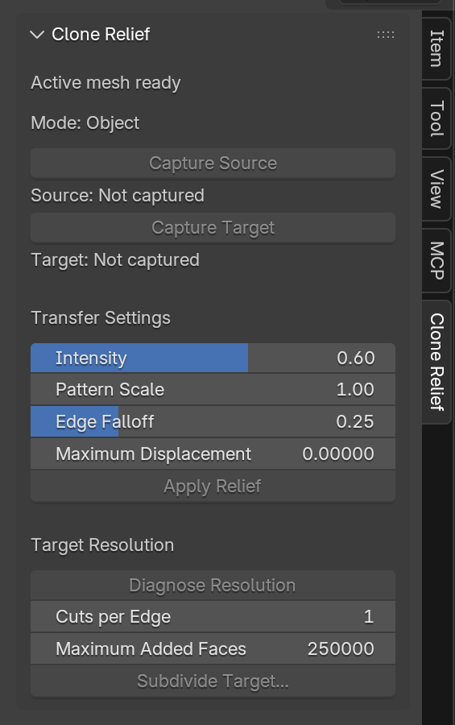

# Guide utilisateur — Clone Relief

**Prototype :** version 0.1.0 pour Blender 4.5.8 LTS. L’outil n’a pas encore
été validé sur le scan Pika ni qualifié pour l’impression 3D.

## Installation sur macOS

1. Dans un Terminal, se placer à la racine du dépôt et construire l’archive :

   ```bash
   python3.11 scripts/build_addon_zip.py
   ```

   L’archive est créée dans `dist/blender_clone_relief_0.1.0.zip`.
2. Dans Blender 4.5.8, ouvrir **Blender → Preferences** puis **Get Extensions**.
3. Dans le menu en haut à droite, choisir **Install from Disk…** et ouvrir
   l’archive créée à l’étape 1.
4. Dans les préférences, chercher **Clone Relief** et activer l’add-on.
5. Dans la vue 3D, ouvrir la barre latérale avec **N**, puis choisir l’onglet
   **Clone Relief**.

À l’activation de l’add-on et à l’ouverture d’un fichier Blender, la vue est
préparée en **Solid**, avec **X-Ray désactivé** et la sélection de faces active.

Blender 4.5 documente l’installation depuis un fichier ZIP, y compris pour les
add-ons historiques, dans le [guide officiel des Add-ons](https://docs.blender.org/manual/en/4.5/editors/preferences/addons.html).

## Protocole conseillé : capturer, prévisualiser, appliquer

Toutes les captures et l’application du relief se font en **Edit Mode**, sur le
même objet maillé :

1. Sur une copie de travail et en **Edit Mode**, choisir l’ombrage **Solid** et
   désactiver **X-Ray** afin que la sélection ne traverse pas l’objet. Sélectionner
   les faces d’une zone saine assez texturée, puis cliquer **Capture Source**.
   Le panneau donne le nombre de faces et de sommets capturés.
2. Sélectionner les faces de la zone cible, puis cliquer **Capture Target**.
   Les faces doivent former un morceau continu, relié par des arêtes. Si la
   sélection touche aussi de petits morceaux disjoints, l’outil garde le groupe
   dominant seulement s’il contient au moins deux fois plus de faces que tous
   les autres réunis; il affiche alors le nombre de faces écartées. Sinon, il
   refuse la capture. La source et la cible doivent être sans face commune.
3. Cliquer **Preview Effect**. L’aperçu ne modifie pas le maillage : il indique
   combien de sommets bougeraient et le déplacement maximal en millimètres.
4. Si le panneau signale une cible trop grossière, lancer
   **Diagnostiquer la résolution**, puis **Densifier la cible…** et vérifier le
   nombre de faces estimé avant de confirmer. Densifier signifie ajouter des
   sommets et des faces à la zone cible pour qu’elle puisse représenter des
   détails plus fins. La subdivision invalide les captures :
   recapturer source et cible, puis refaire l’aperçu.
5. Si l’aperçu annonce un déplacement inférieur à **0,05 mm**, essayer le
   **Relief Gain** suggéré ou capturer une source plus texturée. Refaire
   l’aperçu jusqu’à obtenir une amplitude adaptée au résultat recherché.
6. Cliquer **Apply Relief**. Le panneau indique si l’opération a réussi, le
   nombre de sommets déplacés et leur déplacement maximal. Après application,
   la cible doit être recapturée pour un nouveau transfert. L’opération est
   annulable avec **Undo**.

Si le résultat appliqué est trop faible et que vous voulez le remplacer,
utiliser **Undo**, recapturer la cible, régler le gain, relancer l’aperçu puis
appliquer. Cela évite d’empiler plusieurs transferts sur la même zone.

La barre latérale affiche les comptes de faces et sommets capturés ainsi que le
dernier résultat ou message d’erreur. Un changement de topologie invalide les
captures.

Une capture refusée avec plusieurs groupes indique le nombre de morceaux
séparés par des arêtes. Garder uniquement le morceau souhaité et recapturer;
une tentative refusée ne remplace pas une capture antérieure valide. Si un
groupe dominant est retenu automatiquement, vérifier le nombre de faces
écartées avant de poursuivre.

## Réglages

| Réglage | Défaut | Effet |
|---|---:|---|
| Intensity | 1,00 | Copie le profil complet; une valeur plus faible réduit son amplitude. |
| Relief Gain | 1,0× | Multiplie l’amplitude transférée; une valeur supérieure à 1 exagère le relief. Réglable jusqu’à 100×. |
| Pattern Scale | 1,00 | Échelle physique du motif; 2,00 double sa longueur d’onde. |
| Edge Falloff | 0,25 | Largeur relative du fondu depuis le bord cible. |
| Mode de transfert | Unidirectionnel | Copie le profil source en le décalant vers l’extérieur juste assez pour ne pas passer sous la cible. Le mode bidirectionnel conserve son profil signé autour du plan moyen. |
| Maximum Displacement | 0 | Aucun plafond; une valeur positive limite le déplacement en unités de scène. |

**Preview Effect** calcule le résultat sans changer les coordonnées du maillage.
**Apply Relief** est la seule de ces étapes qui déplace les sommets.

Pour copier le profil sans changer son amplitude, garder l’intensité à 1, le
gain à 1 et l’échelle à 1. Le fondu atténue volontairement le déplacement
près du bord; réduire sa largeur si l’on veut limiter cette zone de raccord.

Les messages distinguent réussite, faible amplitude, absence de sommet déplacé
et erreur de capture ou de topologie. Ils sont présentés ligne par ligne dans
le panneau dans une zone défilante; chaque ligne peut être sélectionnée, et
**Copier le message** copie le texte complet. Une réussite donne le compte des
sommets modifiés et le déplacement maximal. Un résultat sous 0,05 mm est signalé comme très faible;
ce seuil est un repère visuel, pas une garantie d’impression.

## Diagnostic et densification locale

Après les captures source et cible, **Diagnose Resolution** compare le 90e
percentile de longueur d’arête cible à la médiane de la source. Au-delà de
`1,5×`, le panneau signale une cible potentiellement trop grossière et propose
un nombre de coupes. Ce seuil est indicatif; il ne garantit pas que le motif
transféré sera correctement échantillonné.

**Subdivide Target…** ouvre une boîte de confirmation avec le nombre de coupes,
une estimation prudente du nombre de faces et le plafond ajouté (250 000 par
défaut). Vérifier l’estimation avant de confirmer. La subdivision conserve les
positions des bords et peut subdiviser les faces voisines qui partagent les
arêtes de la cible. Après l’opération, recapturer source et cible.

## Validation sur une copie de la courge

Ne pas commencer sur l’original. Faire une copie du fichier ou du maillage de
travail, puis :

1. Confirmer les dimensions physiques et l’échelle objet dans Blender.
2. Choisir une zone source saine et une zone cible triangulée sur le même
   objet; éviter les bords ouverts, plis serrés et régions très courbes.
3. Capturer les régions et lancer **Diagnose Resolution**. Consigner les
   valeurs source/cible et l’estimation.
4. Si la cible est sous-échantillonnée, choisir **Subdivide Target…**, vérifier
   le plafond et confirmer sur la copie.
5. Recapturer les deux régions, appliquer les réglages par défaut, puis
   examiner le relief sous lumière rasante.
6. Comparer avant/après, vérifier les bords et la topologie, puis faire un
   export de contrôle STL et l’ouvrir dans Bambu Studio.

Le transfert crée un motif plausible; il ne récupère pas les détails réellement
perdus du scan. Le prototype ne remplace pas une vérification des
auto-intersections, des parois internes, du manifoldness ou de la fabricabilité.

## Image du panneau

Panneau capturé dans Blender 4.5.8 sur macOS :



La capture montre le panneau en Object Mode; les commandes de capture et
d’application s’activent en Edit Mode.
