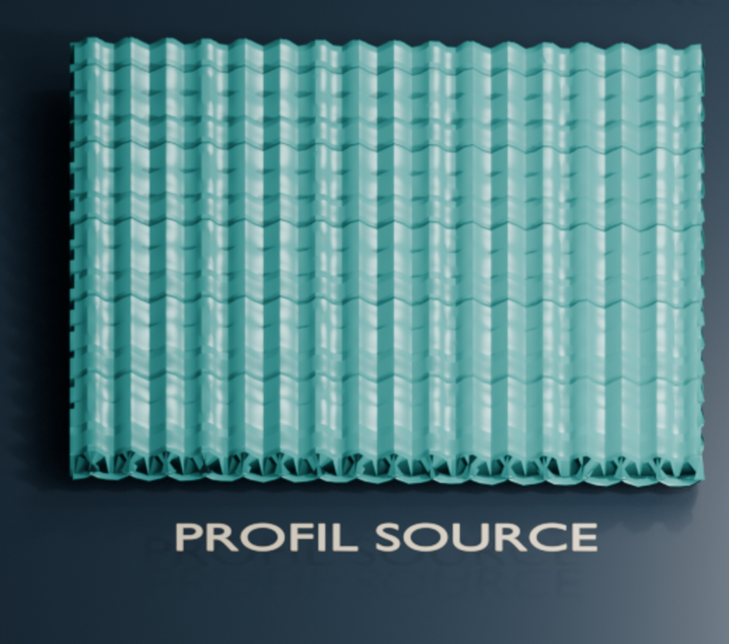
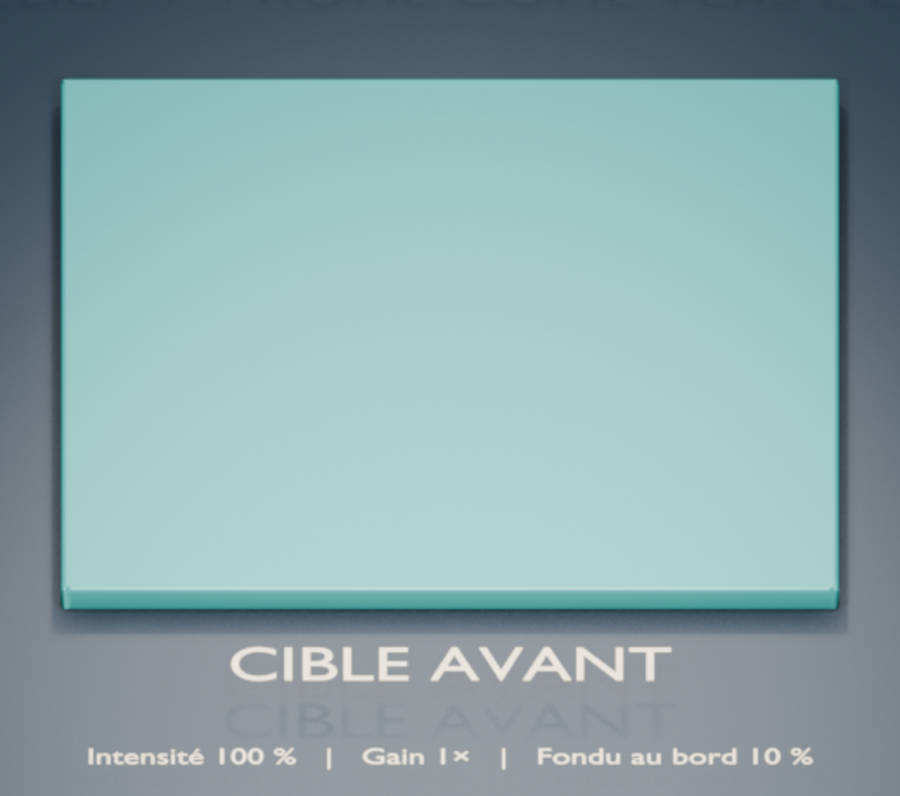
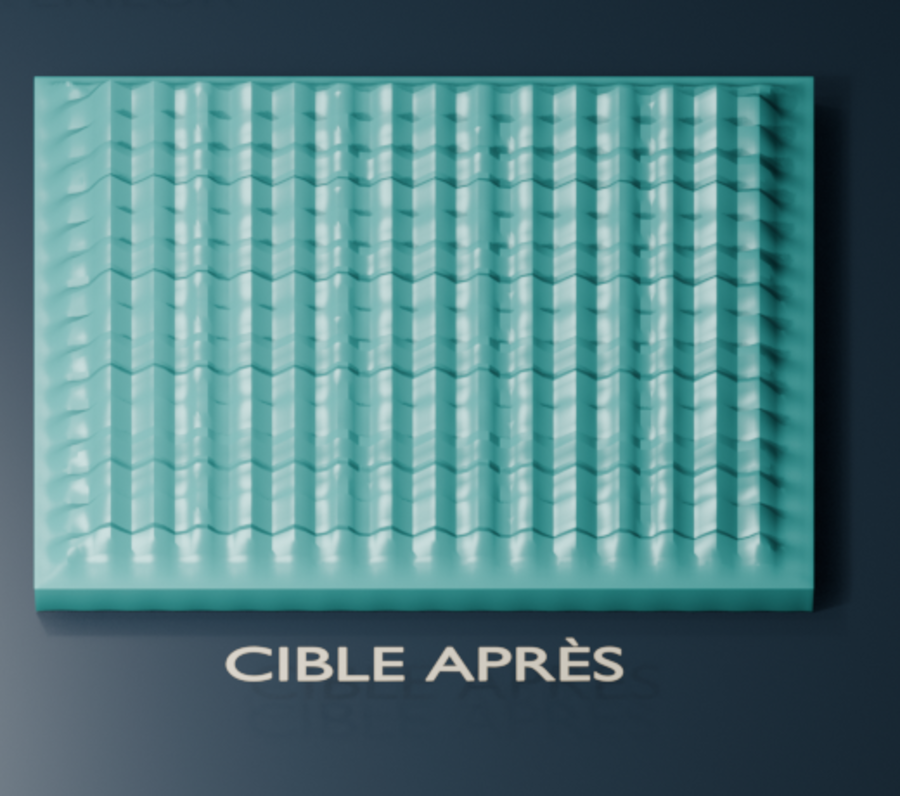

# Before/after example


This synthetic example compares the sampled source profile, the flat target
before transfer, and the target after transfer.



*The source profile used by the example scene.*



*The target is flat before the relief is applied.*



*The source pattern appears on the target after transfer.*

The scene uses the Clone Relief operators in Blender 4.5.8 with **Intensity
1.0**, **Relief Gain 1×**, **Pattern Scale 1.0**, **Edge Falloff 0.10**, and
the default unidirectional mode. The source is a regular sine-wave pattern;
the target has 20,736 faces across a 30 mm tile, and the source has 5,184
faces. The profile is copied at 1× gain with an edge falloff. This render does
not predict results on a real scan.

- [PNG image](clone_relief_before_after.png)
- [English 16:9 preview for Blender Extensions](clone_relief_before_after.en.png) — 1920 × 1080 pixels.
- [Editable Blender scene](clone_relief_before_after.blend)
- Generation script: [`scripts/create_before_after_example.py`](../../scripts/create_before_after_example.py)

## Try the captures in Blender

The scene opens with the test mesh active in **Edit Mode**, with face selection
enabled. Its settings are **Intensity 1.0**, **Relief Gain 1×**, **Pattern
Scale 1.0**, **Edge Falloff 0.10**, and unidirectional mode. Selection opacity
is set to **8%**. The ridged source is on the left (amber), and the flat target
is on the right (green). They are two separate islands of the same object.

1. Move the pointer over the source on the left and press **L** to select its
   connected island. Click **Capture Source** in the Clone Relief panel.
2. Deselect with **Option+A**, move the pointer over the target on the right,
   and press **L**. Click **Capture Target**.
3. Set **Intensity** to `1.0`, **Relief Gain** to `1`, and **Edge Falloff** to
   `0.10`, then click **Preview Effect** and **Apply Relief**.

After **Capture Target**, you can adjust the settings, preview again, and apply
multiple times. Each application starts from the captured initial geometry and
replaces the previous result. Capture a new target only to change regions or
after changing topology. **Selection Opacity** in the panel reduces the orange
selection fill in the 3D View.

**Apply Relief** modifies the target in the `TEST` mesh in place. The
`After - transferred relief` object is a presentation object generated by the
script and does not follow later applications to `TEST`. To compare the
presentation objects in the 3D View, hide `TEST` and show `Before - smooth
target` and `After - transferred relief`; do the reverse to work with the test
mesh.

Unidirectional mode copies the source profile without clipping its valleys,
then offsets it so the target vertices do not pass below its surface. At 100%
intensity and 1× gain, the interior profile matches the source up to a constant
translation. The 10% edge falloff softens only the border. Bidirectional mode
is available to preserve signed valleys and peaks.

The rendered comparison scene is available with **F12**. The test mesh is
excluded from rendering so that it does not cover the three display panels.

To regenerate the scene and image from the repository root:

```bash
"/Applications/Blender.app/Contents/MacOS/Blender" \
  --background --factory-startup \
  --python scripts/create_before_after_example.py
```
